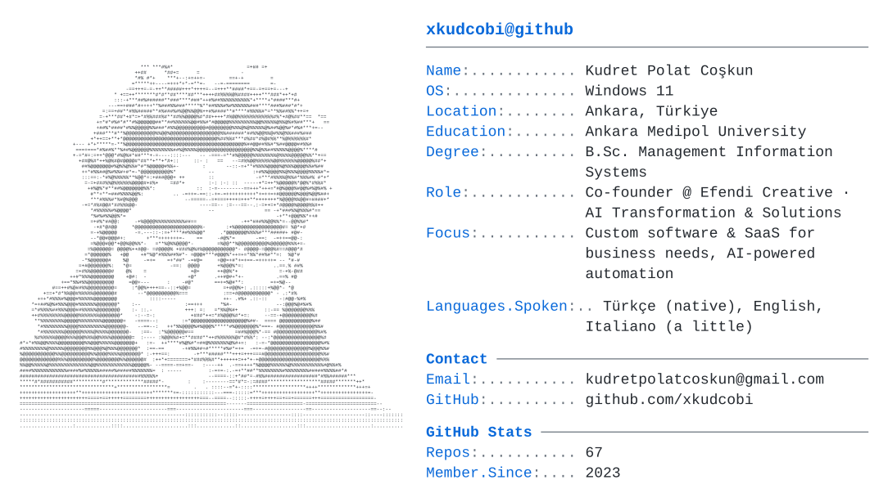

<a href="https://github.com/xkudcobi">
  <picture>
    <source media="(prefers-color-scheme: dark)" srcset="https://raw.githubusercontent.com/xkudcobi/xkudcobi/46b01a7665ebcd873564d482d6f0487cd904d3f0/dark_mode.svg">
    
  </picture>
</a>

---

# Merhaba, ben Kudret 👋

Yönetim Bilişim Sistemleri mezunuyum. İşin her zaman en çok işletme tarafı ilgimi çekti;
teknolojiyi işletmelerin gerçek ihtiyaçlarına çözüm olarak kullanmayı seviyorum.
Efendi Creative'in kurucu ortağı olarak farklı sektörlerden işletmelere web sitesi,
UI/UX, marka kimliği ve yönetim paneli hizmeti veriyoruz.

### Öne çıkan işler
- **[FLOW](https://github.com/xkudcobi/flow-rms)** – Adisyon, mutfak ekranı, stok, kasa ve CRM'i tek sistemde toplayan restoran yönetim sistemi
- **[Kuyumcu Pano](https://github.com/xkudcobi/kuyumcu-pano)** – Kuyumcular için canlı altın fiyat panosu ve tezgah hesaplayıcı
- **[Villa Park QR Menü](https://github.com/xkudcobi/Calypso_Garden)** – Pansiyon, restoran ve havuz işletmesi için QR menü ve yönetici paneli
- **[Baraka Mimarlık](https://github.com/xkudcobi/baraka-mimarlik)** – İstanbul'daki bir mimarlık ofisi için kurumsal web sitesi
- **[Yiğit Nakliye](https://github.com/xkudcobi/mototransfer)** – Nakliye firması için WhatsApp entegrasyonlu web sitesi

Her projede işletme sahibinin sistemi kendi başına kurup kullanabilmesi için
adım adım kurulum kılavuzları hazırlıyorum.

📫 kudretpolatcoskun@gmail.com · Ankara
